# Hollow Tide

### a conspiracy of clay

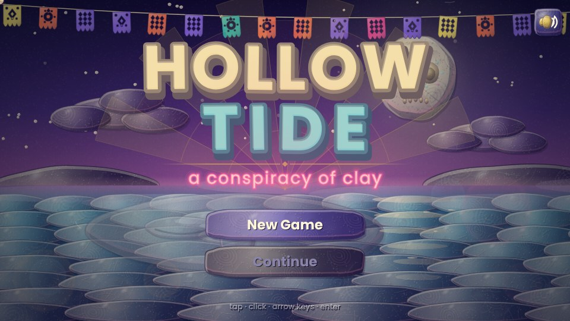

The tide has gone out further than anyone in **Mudhaven** has ever seen. Out past the lighthouse, something pale
has lifted from the shallows like the lid of a closed eye. Forty-one Founders look down from the harbor wall, and every
one of them has the **same thumbprint**.

*Hollow Tide* is a small but complete, playable game (one chapter, four endings) that **plays in the browser and installs
as an app** (phone or desktop, works offline, turns with your screen). It blends three things, with a fourth in the look:

| | what we took | how it shows up |
|---|---|---|
| **Drowned God: Conspiracy of the Ages** | paranoid myth-conspiracy tone: shared origins hidden under many legends, glyphs and sign orders, a truth that reorders everything | a string-board **Journal** of eight notes you tie together into five deductions (some unlock dialogue, one fight and a fourth ending), a four-sign glyph ritual, a Lamp Lock puzzle, an ending that asks what you do with a god |
| **The Neverhood** | a world that looks sculpted by hand and shot frame by frame, deadpan weirdness, point-and-click exploring | everything is lit clay: lumpy shapes that *boil* at 12 fps, fingerprint texture, warm key light, tiny wet glints |
| **Final Fantasy VII (lightly)** | active-time battles, limit breaks, swappable magic slots, a party that grows | **ATB** gauges, the **Fracture** limit meter, **Glazes** (our materia) you slot, swap and master, elemental **conditions that combo** (soak then burn for steam; brittle then hit for a shatter), a boss whose big move you can see coming and put out |

| **Grim Fandango** *(the look)* | noir afterlife style: skeletons in suits, marigolds and cut-paper banners, art-deco trim, neon in the fog | a calavera moon, papel picado bunting, marigold garlands and ofrendas, a buzzing neon sign, gilt deco frames on every panel, long shadows, fog and slatted light, an archivist skeleton who files nothing |

It is original: no characters, text or assets from those games. They are inspirations, not ingredients.

| | |
|---|---|
| 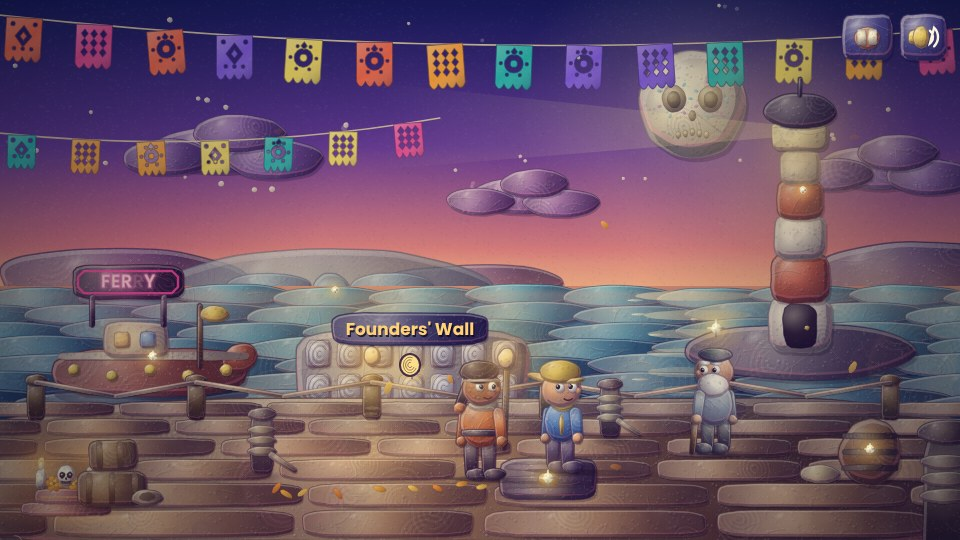 | 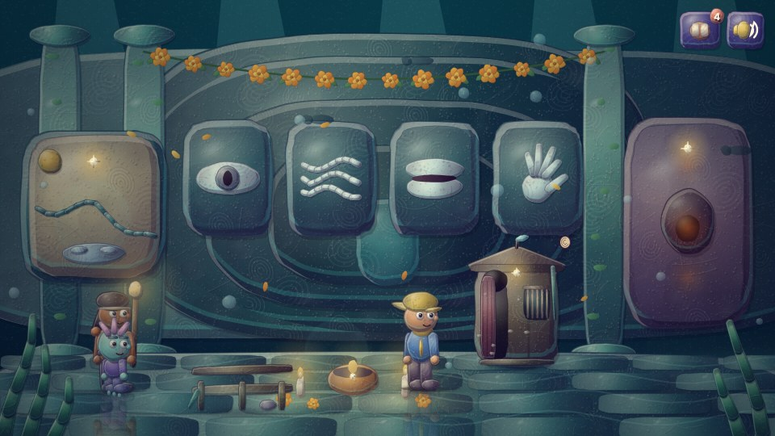 |
| 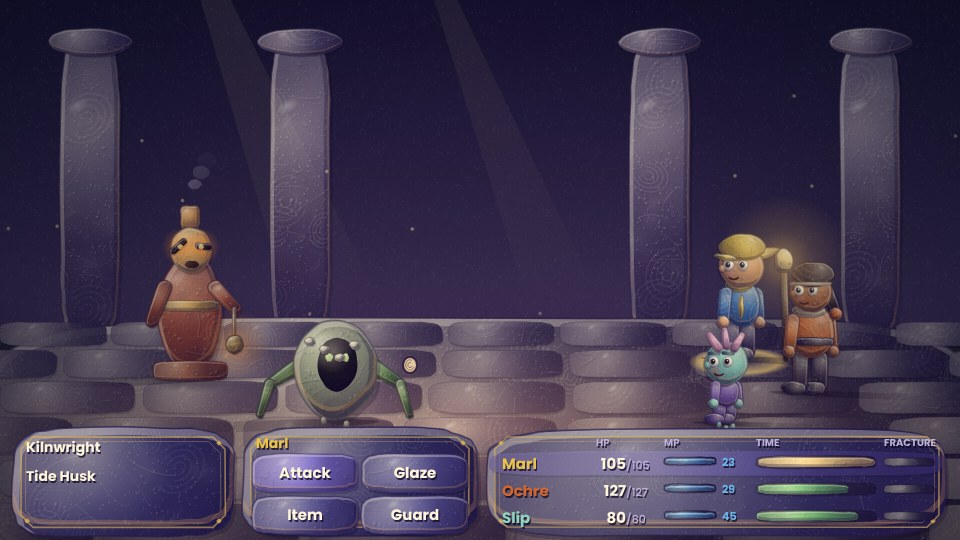 | 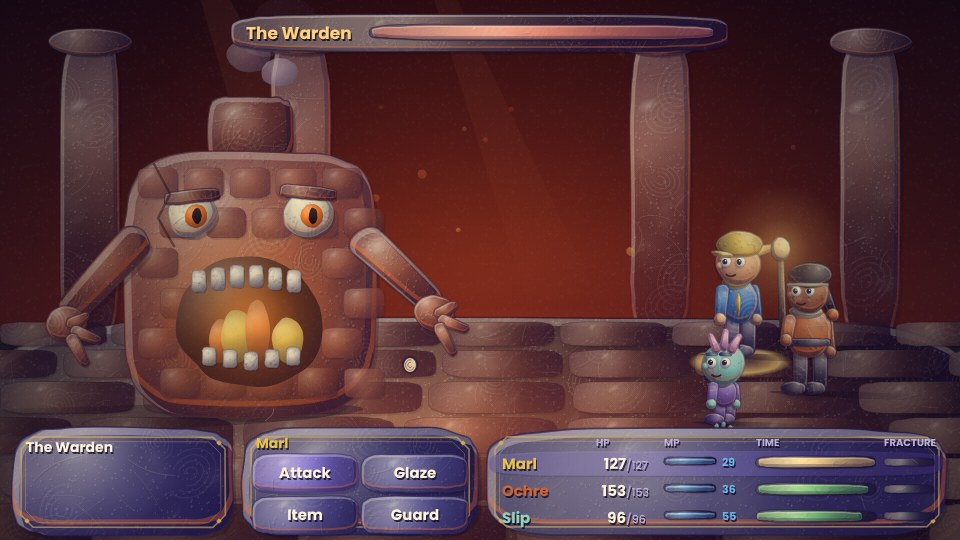 |
| 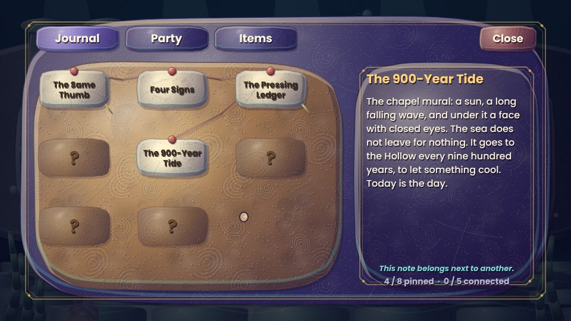 | 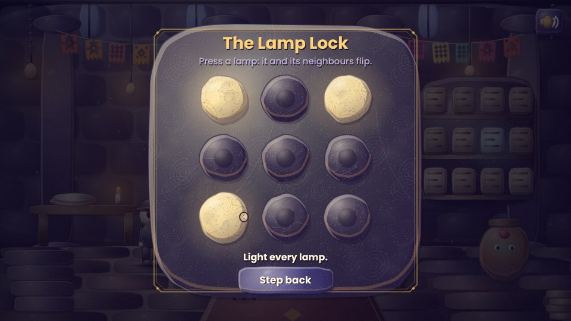 |

And on a phone held upright (the world follows you through a camera; battles and menus re-flow into one column):

| | | | |
|---|---|---|---|
| 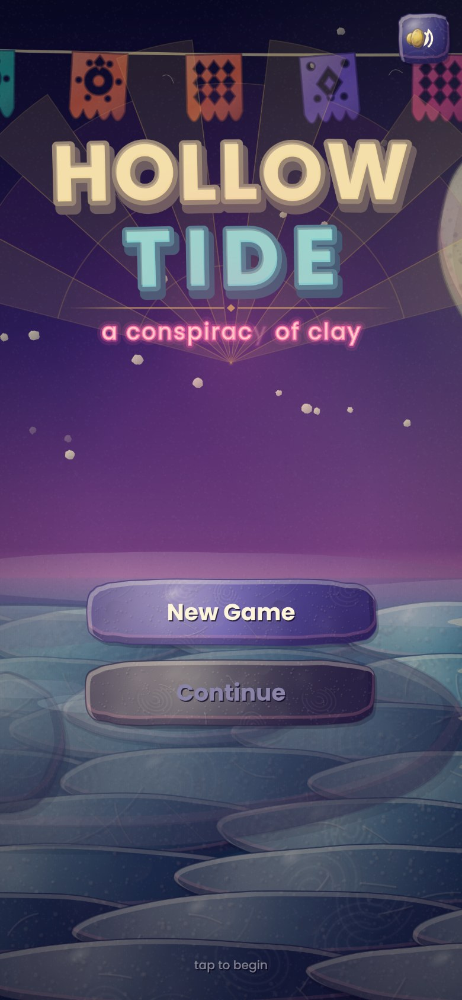 | 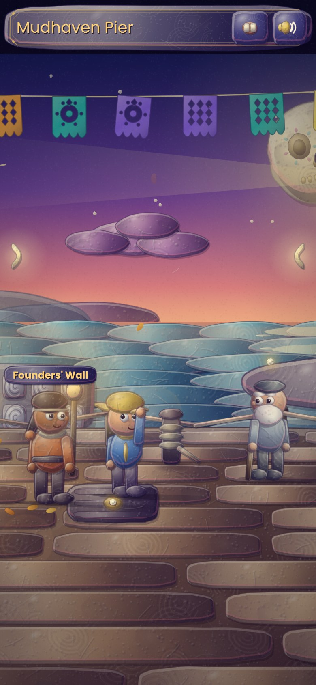 | 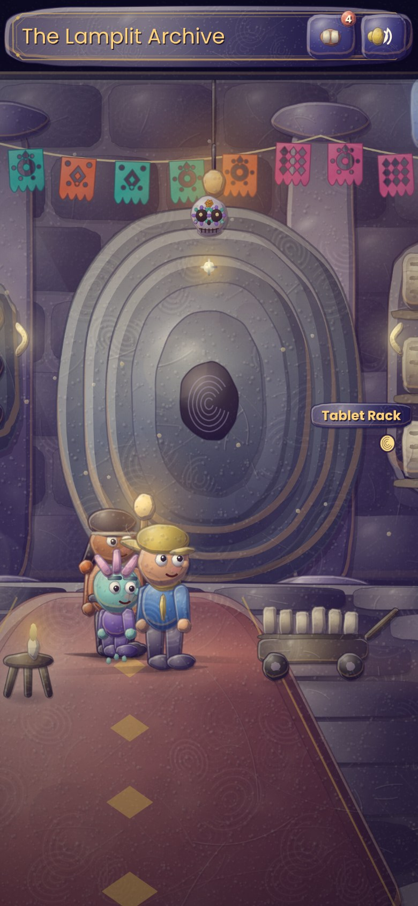 | 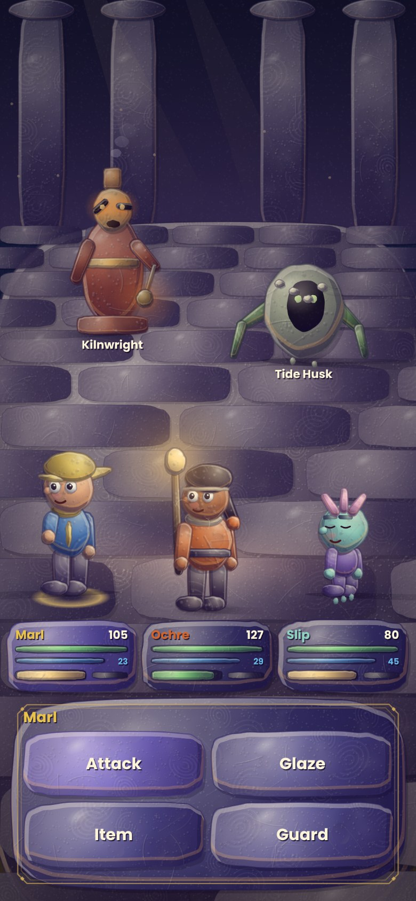 |

The depth pass (conditions on every combatant, walk-behind props, the deduction board):

| | | |
|---|---|---|
| 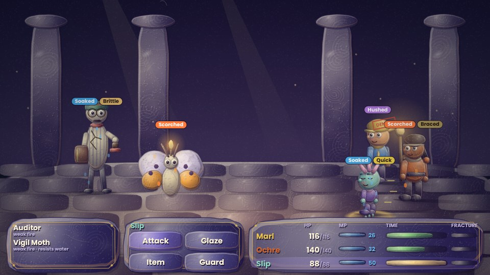 | 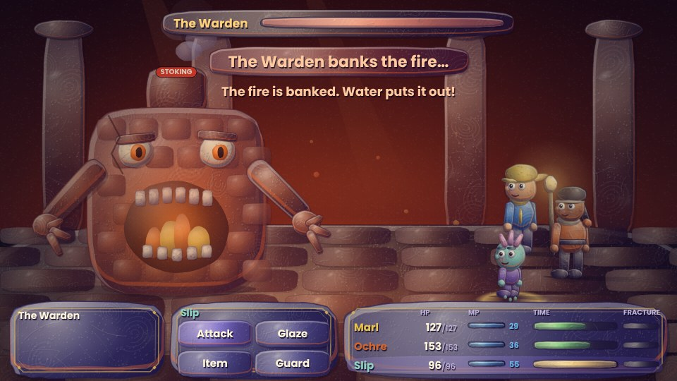 | 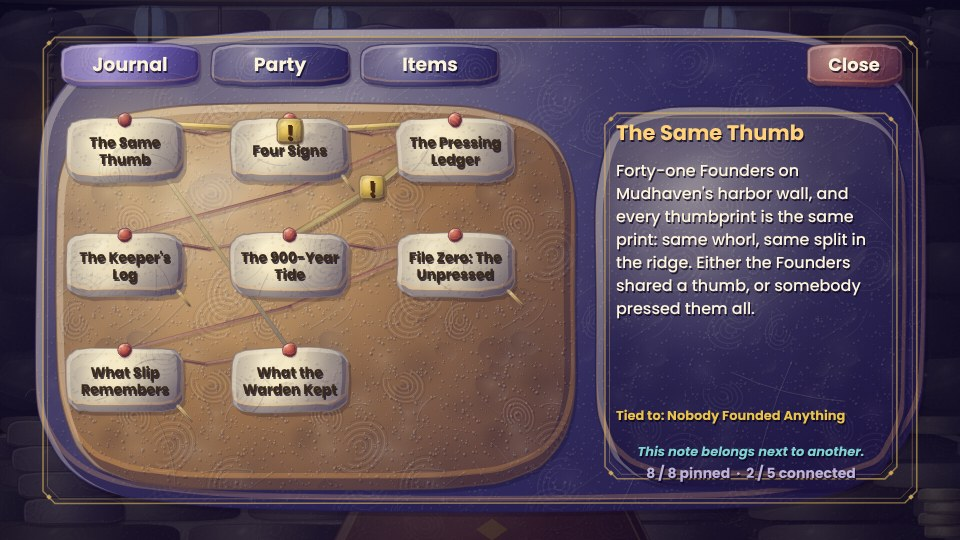 |
| 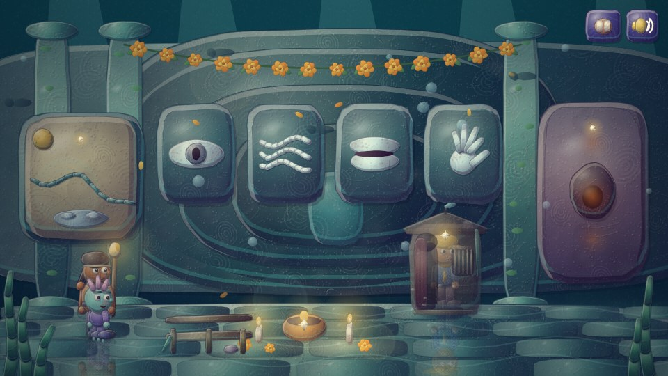 | 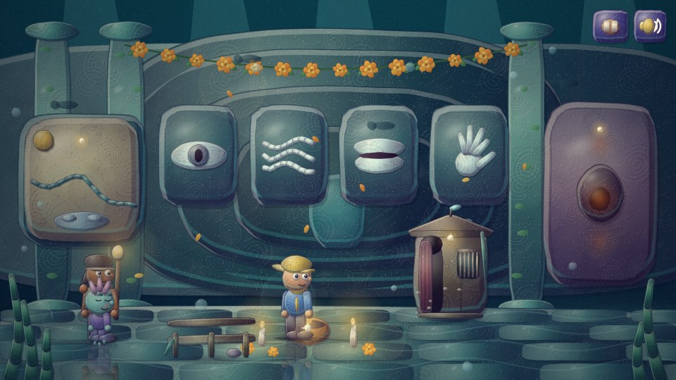 | 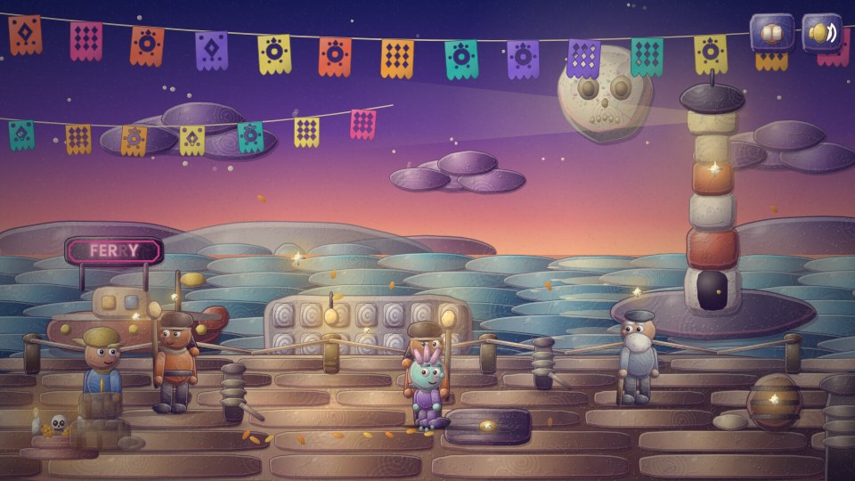 |

*Every image above is a real render of the game in headless Chromium (see `tools/shots.py` and `tools/depth_shots.py`), not a mock-up.*

## Play it

You need nothing but Node 21 or newer (and any modern browser). There are **no dependencies and no npm install.**

```bash
npm start            # dev server on http://localhost:8080  (or: node tools/serve.mjs 3000)
npm run build        # dist/: one self-contained index.html plus manifest, icons and an offline service worker
npm run serve:dist   # serve the built app on http://localhost:8081 (this is the one you can install)
npm test             # 120 tests: unit, balance simulations, full headless playthroughs, render and app-file checks
```

No Node? `python3 -m http.server` in the repo root also works (ES modules need http, not `file://`;
the built `dist/index.html` works from `file://`).

### Controls

| | touch / mouse | keyboard |
|---|---|---|
| walk | tap the ground | arrow keys or WASD |
| look / use / talk | tap a thing (sparkles mean "look here") | Enter / Space / E uses the nearest thing |
| dialogue | tap to advance | Enter / Space |
| journal, party, items, almanac, settings | book button, top right | J or M (Esc opens settings) |
| choices | tap | 1-9, or arrows + Enter |
| battle | tap a command when a name glows, then tap a target | arrows + Enter, Esc to go back |

Play in either orientation. Sideways you get the full 16:9 diorama; upright, the same world scrolls past a follow-camera at
up to 1.6x size, the dialogue box sits at the bottom, and battles stack into one finger-sized column. Rotate mid-game and
everything re-lays out in place. Progress autosaves at every scene change and after every battle.

## Install it as an app

Hollow Tide is a progressive web app: full-screen, its own icon, and it keeps working with no connection once it has loaded once.

- **Android, Chrome or Edge on desktop:** open the hosted game and tap the **Install** button on the title screen (or use the
  browser menu: *Install app*).
- **iPhone / iPad (Safari):** Share, then **Add to Home Screen**. The title screen reminds you once.
- It needs **https** (GitHub Pages provides it) or `localhost`; installing is not possible from a `file://` page or from inside
  an embedded preview. Opening `dist/index.html` directly still plays the game fine, it just can't install.
- Updates arrive on the next launch after a deploy (each build is content-hashed, so the old cache is dropped).
- The only things fetched from the network are the two Google Fonts; they are cached at install time, and the game falls back
  to system fonts if they never load.

This is verified in headless Chromium (`python3 tools/smoke.py` checks that Chromium reports the app installable, relaunches
it **offline**, and rotates the viewport). It has **not** been tried on a physical iPhone or Android phone yet.

## How it plays

- **Explore.** Four hand-built scenes (the pier, the archive, the drowned chapel, the kiln gate) with followers, depth
  scaling, hotspots and a modal pad-and-bells score synthesized live with Web Audio. There are no audio files. The rooms
  have furniture you can walk behind (and see through when it hides you), shadows that swing away from the nearest lamp,
  a wet chapel floor that holds reflections, and people who fidget: Marl scratches under his hat, Hueso tips a fedora to
  nobody, Brine taps his cane, Slip hops.
- **Investigate.** Poke things. Eight notes pin themselves to a 3x3 string board. **Tap one note, then another**: if they
  belong together you tie them into a *deduction* ("Nobody Founded Anything", "Cobb Stayed", "The Unfired Thumb", "Batch Two
  Is Tonight", "The Four Beats"). Deductions change what people say, what the Warden will listen to, and which endings are open.
- **Talk.** Your party has opinions. Ochre (dry, practical) and Slip (a grieving optimist) comment when you poke things, and
  each line plays once. Your **bond** with each of them rises with the choices you make, and the epilogue remembers.
- **Fight.** Active-time battles in *wait* mode (time crawls while you choose). Damage is only half of it:
  *soaked* + fire makes steam (x1.35) and *brittle* + a physical hit shatters (x1.35). Ember leaves a target brittle, Brine
  soaks it and douses a charging foe, a burn ticks every 1.5 s, and *hush* silences glazes. The Auditors stamp *DENIED*
  (hush) and drain MP, the Vigil Moth mends whoever is hurt, and the Warden *stokes* before it *blazes*: put the fire out with water or a Brine Flask. Each glaze levels up
  with use (three ranks, with a new perk each). Taking damage fills **Fracture**, then a limit move turns the fight. Lose and
  the tide gives you back, healed. If you know the Warden's name, you can end that fight without finishing it.
- **Choose.** Four endings, decided at the very last door; what you learned and who trusts you changes which doors are there,
  and a short epilogue (up to four sentences) follows from your fear, your bonds and whether you spared the Warden.

## How it's built

```
index.html            canvas shell (+ manifest, icon and Apple tags)
manifest.webmanifest  app name, colours, icons; orientation "any" so it rotates
sw.js                 offline service worker template (build.mjs stamps and copies it into dist/)
icons/                app icons (regenerate with tools/icons.py; drawn by the game's own renderer)
src/engine/           the clay renderer, character/monster/portrait sculptors, scene painters, Web Audio
  clay.js             lumpy blobs and slabs, boil, fingerprint texture, tool marks, contact shadows, noir film finish
  noir.js             Grim Fandango / Dia de Muertos dressing: papel picado, marigolds, neon, fog, deco trim, sugar skulls
  actors.js           drawFigure / drawEnemy / drawPortrait (procedural sculpts, moods, idle fidgets, the calaca skeleton)
  props.js            set dressing you can walk behind: posts, crates, a book cart, the confessional, a coal cart...
  stage.js            backdrops for every scene + LAYOUT constants shared with the game + the lamp registry
src/game/             rules and presentation
  battle.js           pure ATB battle logic: conditions and combos, telegraphed boss moves, glaze mastery (no DOM, fully unit tested)
  data.js             characters, glazes, enemies, encounters, journal clues and deductions
  banter.js           party banter lines, keyed by scene and hotspot
  battleview.js       animates battle events and turns taps/keys into commands
  scenes.js           each scene: paint, props, hotspots, async story scripts, the epilogue
  game.js             state, save/load, dialogue, walking, input, viewport + follow-camera, render dispatch
  ui.js               clay UI for both orientations: panels, buttons, dialogue, journal, party, puzzle overlay
src/main.js           canvas wiring, rotation-aware sizing, adaptive resolution; src/install.js is the install button
tools/                dev server, zero-dependency bundler, icon + screenshot + browser smoke tooling
test/                 node:test suites (battle math, balance sims, puzzles, bot playthroughs, render and app-file checks)
docs/                 design, art pipeline, roadmap, screenshots
```

Design notes worth knowing before you hack:

- **Story scripts are plain `async` functions** that `await g.say(...)`, `g.ask(...)`, `g.battle(...)` and `g.go(...)`.
  Adding a scene is mostly writing a script.
- **Battle logic is pure.** `battle.js` never touches the DOM, so balance is tested by simulation: a scripted bot fights
  each encounter hundreds of times and the tests assert win-rate *bands* (the Warden is beatable at the expected level but
  not a pushover).
- **A bot plays the whole game headlessly** in `test/playthrough.test.js` and reaches all four endings, which catches
  softlocks and unreachable story beats.
- **A render smoke test** drives every screen, in four phone and desktop shapes, through a stub canvas context to catch the
  kind of bug where one missing import silently blanks half a UI, and checks that every draw call leaves the canvas state
  clean. (Appearance is judged separately, in a real browser: `tools/shots.py`, `tools/smoke.py`.)

See [`docs/DESIGN.md`](docs/DESIGN.md), [`docs/ART_PIPELINE.md`](docs/ART_PIPELINE.md) and [`docs/ROADMAP.md`](docs/ROADMAP.md).

## Hosting

`.github/workflows/pages.yml` runs the tests, builds `dist/` (page, manifest, icons, service worker) and deploys it to GitHub
Pages on every push to `main`. Enable it once under **Settings → Pages → Build and deployment → Source: GitHub Actions**.
Pages serves over https, which is what makes the app installable.

## License

MIT. See [`LICENSE`](LICENSE). *Drowned God: Conspiracy of the Ages*, *The Neverhood*, *Final Fantasy VII* and *Grim Fandango*
are the property of their respective owners; this project is an independent homage and uses none of their material.
